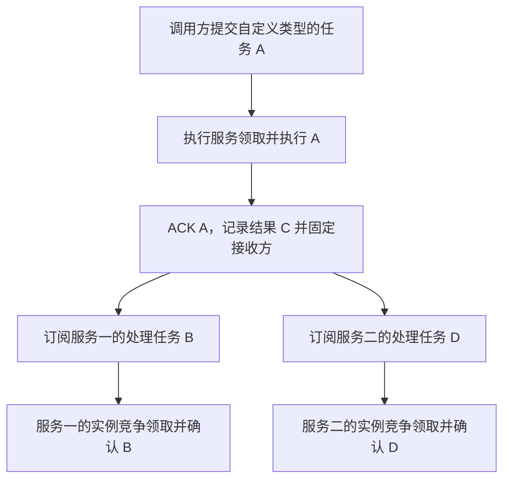

## 平台契约与应用契约

调用方提交任务，执行服务领取并回报结果，订阅服务通过自己的队列处理结果。同一服务可以同时提交和执行任务。管理员按业务范围、任务类型和队列授予具体操作权限。

| 契约 | 由谁定义 | 示例 |
| --- | --- | --- |
| 调度协议 | 平台 | task_id、queue、worker_id、租约、ACK/NACK |
| 结果交付 | 平台 | source_task_id、completion_id、summary 对象、可选的 artifacts 引用列表 |
| 任务类型和数据 | 使用者 | 任意类型名、payload 和 summary 的键、产物格式、订阅服务自己的输入结构 |

拟在提交接口和订阅管理中使用 `task_type` 表示使用者定义的任务类型。项目尚未上线，实施时将现有实现中的 `collection_type` 统一命名为 `task_type`。类型名与执行阶段分开：原 `task_kind` 描述普通任务、产生结果的源任务或下游处理任务。源任务是否启用结果派发由类型配置决定。首版沿用一层派发，下游任务 ACK 结束本次处理。

两个处理任务共享来源 A 和完成记录 C，各有自己的任务 ID、状态和租约。订阅服务在自己的入口把摘要或产物引用转成所需输入。仅返回 JSON 摘要也能完成派发。

**应用示例。** 文档渲染服务可定义 `document.render`，在 `summary` 返回页数，在 `artifacts` 给出 PDF 引用；归档和预览服务各领一条处理任务。同样，商品采集服务可定义 `product_link`，在 `summary.context` 写入商品 ID，在 `artifacts` 给出 HTML 引用；ETL 和质检分别订阅。两例使用同一 HTTP 协议，字段名、文件格式和存储方式由应用约定。

## 公开任务 API 命名

以下路由使用共同前缀 `/api/v1`，路径中的 `task_id` 为源任务 ID。

| 方法与路径 | 含义 |
| --- | --- |
| `GET /tasks/{task_id}/deliveries` | 查看这次完成的下游投递 |
| `GET /tasks/{task_id}/artifacts` | 获取结果产物引用 |
| `POST /tasks/{task_id}/deliveries/{recipient_service}/{step}/rerun` | 复用已保存结果，只补跑指定的订阅步骤 |
| `POST /tasks/{task_id}/rerun` | 创建关联的新源任务，重新执行业务以产生新结果 |

对外模型统一将 `collection_type`、`collection_task_id`、`child_collection_task_ids` 分别命名为 `task_type`、`source_task_id`、`child_source_task_ids`。统计字段 `collection_succeeded_count` 和 `collection_ready` 对应改为 `source_succeeded_count` 和 `source_ready`。对外 `task_kind` 中的源任务值使用 `source`；普通任务和下游处理任务继续使用 `normal` 和 `processing`。OpenAPI 的路径、模型和操作名称以及 SDK、文档示例使用同一词汇，已有失败任务的 `retry` 与显式重新执行的 `rerun` 分别保留原有语义。

## 开通身份、凭证与订阅

建议在 MySQL 中区分稳定的主体、可轮换的凭证、操作授权和订阅。部署管理员在受控环境使用 CLI 完成首次开通，生成高熵随机 token，仅在签发时输出一次，数据库保存可查询的凭证标识、校验摘要、所属主体与有效状态。通过部署 Secret 分发，HTTPS 请求携带 Bearer token。轮换时先发新凭证，切换后吊销旧凭证。订阅和积压归属稳定服务身份。

| 主体 | 管理员开通 | 日常调用 |
| --- | --- | --- |
| 业务方 | 所属业务及允许提交的任务类型或普通队列 | submit |
| 执行服务 | 可消费的任务队列 | pull、heartbeat、ack、nack |
| 订阅服务 | 各自业务范围的订阅和对应消费队列 | 从自己的处理队列 pull，按任务回报 |
| 管理员 | 部署侧管理权限、只读实例查询权限 | 管理 CLI、在线 Worker 查询 |

HTTP 订阅以 `(business_id, task_type, recipient_service, step)` 唯一。重复开通同一绑定返回原记录。管理命令指定目标队列，同时开通领取权限。不同接收服务或需要相互隔离的业务使用不同队列，因为现有 pull 按队列抢占。动态订阅和凭证以数据库为权威来源，API 多副本和独立派发进程读取同一套配置。首次部署由管理员开通需要的订阅。附加接收方继续按显式授权和本次请求选择。运行时由数据库决定 HTTP 订阅启停，ACK 按服务和步骤去重，避免静态配置重新启用已停用的订阅。凭证吊销后，各入口均须拒绝使用该凭证。

启用结果派发的类型允许没有有效接收方，仍可配置、提交和领取。源任务成功 ACK 时，若接收方快照为空，事务保存终态和完成记录，返回稳定的 `completion_id` 和 `dispatch_count: 0`。相同 ACK 重放复用原结果，之后新增的订阅只接收新完成的结果。

订阅停用影响之后确认的源任务结果。此前快照生成的待办仍可派发，已授权的 Worker 可以排空队列；撤销消费权限另行执行。新订阅从生效后的源任务完成记录开始。已有订阅者恢复后领取未完成任务，重试按任务状态和租约推进，无需提交消费位点。

## 管理接口的访问范围

在业务和管理路由入口统一认证，再由具体操作校验权限与资源归属。管理员可获得全局权限，业务运维可只管理指定业务和队列。列表、详情、缓存查询和聚合统计沿用同一范围，列表先限定可见数据再分页。来自客户端的队列名、业务 ID 或过滤条件只能缩小范围。

| 接口 | 所需授权 |
| --- | --- |
| 任务列表、详情、投递链路、产物引用 | 读取该业务或任务的权限。单任务重试、重跑另需目标范围的执行管理权限 |
| 死信查看与批量重试 | 查看死信使用队列只读授权。批量重试使用该队列的死信重试授权，显式传入任务 ID 时先核对每条任务的真实队列和归属，再开始处理 |
| 队列统计、积压、服务统计 | 对相应队列或业务的监控只读授权。全局监控凭证可读部署级指标，展示 IP 的 Worker 列表沿用管理员权限 |
| Cron 列表与详情 | 规则的业务范围以及 Cron 读取权限 |
| Cron 创建、修改、启停、删除 | 规则范围的 Cron 管理权限。创建、启用和触发投递还需校验当前业务对目标队列的提交授权 |
| Prometheus 指标 | 抓取端使用部署级监控只读凭证。最小存活探针可单独放行，仅返回健康状态 |

Cron 记录须持久化授权归属。调度循环代表该主体执行，撤销其投递权限后，后续触发不得以调度器自身权限继续入队。匿名或无效凭证返回 401，认证通过但没有相应操作权限返回 403。

## Worker 实例与管理员查询

实例直接 pull 即可。一个进程统一领取、多个线程处理时，共用一个实例 ID；每个线程独立领取时，可给每个线程分配独立 ID。每个任务保留自己的 ID 和租约代次。服务身份来自认证上下文，由任务持有者与本次领取代次共同约束续租和回执，避免另一服务冒用相同 worker_id。

建议提供 `GET /api/v1/admin/workers`，可按 `service_name`、`queue` 过滤。响应包含 `online_count`、`online_window_seconds` 和 `workers[]`。每项含 `worker_id`、`service_name`、`queues`、`last_seen_ip`、`last_seen_at`。实例按服务身份和 worker_id 去重，队列过滤按该队列最近活动判断。来源 IP 由网关或服务端连接获得，仅信任部署指定代理的转发信息。同一 NAT 后的实例可具有相同 IP。

复用 Redis TTL 记录成功 pull（含空拉取）和成功任务 heartbeat，默认窗口 60 秒。查询反映近期活动。如果固定租约为 20 分钟，Worker 长时间既未 pull 也未续租，可能从近期活跃列表消失；它持有的任务仍以自己的租约为准。订阅持续有效，Worker 离线期间下游任务可以积压。

## Python Worker SDK 的交付

首版在同一仓库的 `sdk/python/` 维护 Python 客户端，使用自己的 `pyproject.toml` 声明版本、构建方式和客户端运行依赖，构建可单独安装的 wheel。接入方在其 Worker 进程中导入 SDK，通过公开的 HTTP/JSON 协议访问调度器。协议示例和集成测试在同仓库同步维护，SDK 仅依赖公开协议与客户端库。

仓库开发时可从子目录安装；业务项目部署时可固定 SDK 版本并安装对应 wheel。公共 PyPI 是后续可选的发布渠道，首版交付通过构建和独立安装验收。

## 固定租约、可选续租与限速

- **固定租约**适合耗时可估的任务。提交时指定 `lease_seconds`（现有默认 60 秒，范围 1–86400 秒）。预计 10–15 分钟完成时可给 20 分钟；Worker 完成即 ACK。若领任务后立即退出，回收可能要等到这 20 分钟结束。
- **自动续租**适合时长波动大或需快速接手的任务。共用客户端在到期前用本次 worker_id、task_id、lease_generation 调用 heartbeat。续期从服务端当前时间计算。一个进程可用一个后台线程或协程管理多条独立租约。收到已失去租约的响应后终止对应执行，避免再提交结果。
- **执行截止时间**由客户端约束一次业务执行。按任务配置外部 I/O 或等待操作的超时；达到截止时间时取消或关闭实际操作、停止续租，并在仍持有租约时按错误性质 NACK。阻塞式 I/O 可用独立续租线程。对无法取消的阻塞库可隔离执行，并在回收前结束该执行。现有端到端超时统计衡量交付耗时。
- **外部依赖限速**由使用者按依赖的配额约束实际请求。多个执行实例共享配额时由应用协调限速，客户端按空闲执行槽领取任务。

## 交付顺序

先打通账号开通、授权和持久订阅，再以自定义类型验收执行、派发和两个订阅者的独立恢复。优先提供客户端以减少执行服务接入工作量，最后补管理员活跃实例视图。所有示例 ID、角色名和时间均用于说明。
