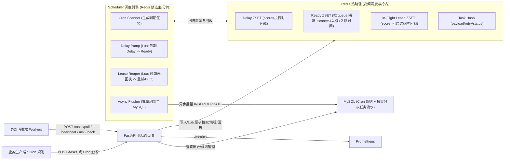

# Design: Coffee Scheduler 系统架构与技术设计

## 1. 总体架构



## 2. Redis 热路径数据结构与 Lua 原子操作

| Key 模式 | 类型 | 用途 | 清理/过期策略 |
| :--- | :--- | :--- | :--- |
| `cs:task:{task_id}` | Hash | 存储 `queue`, `priority`, `payload`, `status`, `retry_count`, `max_retries`, `lease_ttl`, `created_at` | 终态后设置 TTL（如 24h）自动淘汰 |
| `cs:idemp:{key}` | String | 幂等键防重，值为 `task_id` | 提交时 `SET NX EX`（如 24h） |
| `cs:delay:{shard}` | ZSET | 延迟/重试任务队列，`member=task_id`, `score=next_run_at_ms`（按 `task_id` hash 分 16 片） | `pump.lua` 到期弹出 |
| `cs:ready:{queue}` | ZSET | 按业务 `queue` 隔离的就绪优先级队列，`score = (9 - priority) * 1e13 + ready_at_ms`（支持 0~9 级，同优先级按时间 FIFO，53-bit float 精度安全） | `pull.lua` 通过 `ZPOPMIN` 弹出 |
| `cs:lease:{queue}` | ZSET | 已拉取执行中的任务，`member=task_id`, `score=expire_at_ms` | `ack`/`nack` 移出，或 `lease_reap.lua` 超时回收 |
| `cs:dlq:{queue}` | List | 超过最大重试次数的死信任务 ID | 人工排查/重跑后清理 |

### 核心 Lua 脚本职责
- **`pump.lua`**：从 `cs:delay:{shard}` 取出 `score <= now_ms` 的批量任务（如每次最多 200 条），将其从 ZSET 移除并按任务的 `priority` 计算复合分值写入 `cs:ready:{queue}`，更新任务状态为 `READY`。
- **`pull.lua`**：从 `cs:ready:{queue}` 使用 `ZPOPMIN` 原子弹出最多 `batch_size` 条最高优先级任务，写入 `cs:lease:{queue}`（`score = now_ms + lease_ttl * 1000`），更新任务状态为 `RUNNING` 并返回任务详情。
- **`heartbeat.lua`**：校验任务处于 `RUNNING` 且归属当前 `worker_id`（可选），刷新 `cs:lease:{queue}` 的 `score`。
- **`ack.lua`**：从 `cs:lease:{queue}` 移除任务，更新状态为 `SUCCEEDED`，设置 `cs:task:{task_id}` 过期时间。
- **`nack_or_reap.lua`**：从 `cs:lease:{queue}` 移除任务；若 `retry_count < max_retries`，则 `retry_count + 1`，按指数退避计算 `next_run_at_ms = now_ms + base * (2 ** retry_count)` 并重新写入 `cs:delay:{shard}`；否则写入 `cs:dlq:{queue}` 并标记 `DEAD`。

## 3. MySQL 持久化设计

### `cron_jobs` 表（规则表）
- 字段：`id`, `name`, `queue`, `priority`, `cron_expr`, `payload (JSON)`, `max_retries`, `lease_seconds`, `enabled`, `next_run_at`, `version`, `created_at`, `updated_at`
- 通过乐观锁或 Scheduler 主节点锁保证每次到期只生成一条任务实例。

### `task_records_YYYYMMDD` 表（按天分表流水）
- 字段：`task_id (PK)`, `queue`, `priority`, `status`, `payload (JSON)`, `receipt (JSON, ≤16KB)`, `retry_count`, `worker_id`, `scheduled_at`, `finished_at`, `created_at`
- **异步批量刷盘（Async Flusher）**：API 与 Scheduler 将需要落库的事件（创建、终态、死信）放入内存异步队列（`asyncio.Queue`），后台协程每 `100ms` 或累积 `500` 条执行一次 `INSERT ... ON DUPLICATE KEY UPDATE` 批量写入 MySQL。

## 4. 回执 Payload 标准化契约（多态 `artifacts`）

```json
{
  "worker_id": "crawler-node-07",
  "duration_ms": 1420,
  "summary": {
    "total_count": 500,
    "success_count": 498,
    "failed_count": 2
  },
  "artifacts": [
    {
      "storage": "oss",
      "uri": "oss://bucket/20261125/task_98765.parquet",
      "meta": { "format": "parquet", "size_bytes": 204800 }
    },
    {
      "storage": "kafka",
      "uri": "kafka://prod-cluster/topic-scraped-items",
      "meta": { "partition": 3, "offset_start": 10200, "offset_end": 10697 }
    },
    {
      "storage": "redis",
      "uri": "redis://cache-01/db0/crawl:result:98765",
      "meta": { "data_type": "list", "ttl_seconds": 3600 }
    }
  ],
  "extra": {}
}
```
- 网关校验：单条 `ack`/`nack` 请求体严格限制 ≤ 16KB，超限直接返回 `413 Payload Too Large`。

## 5. V1 查询接口设计（冷热联合 + 分区裁剪）

1. **`GET /api/v1/tasks/{task_id}`（单任务详情与回执）**
   - **冷热联合读取**：优先读 Redis `cs:task:{task_id}`（获取毫秒级实时态如 `RUNNING`、`worker_id`、`retry_count`）；若 Redis 已过期淘汰，则从 `UUIDv7` 的 `task_id` 提取创建时间，附带 `created_at` 范围查询 MySQL `task_records`（触发单日分区裁剪）。
2. **`GET /api/v1/tasks`（任务列表检索与分页）**
   - 支持按 `queue`、`status`、`worker_id`、`start_time` / `end_time` 筛选。
   - **防全表扫描保护**：未传时间范围时默认限定查询最近 24 小时（最大跨度限制 7 天），强制命中 MySQL 分区裁剪。
   - **游标分页**：基于 `(created_at, task_id)` 游标向后翻页（`cursor` + `limit` ≤ 100），避免千万级表 `OFFSET` 深分页。
3. **`GET /api/v1/queues/{queue}/stats`（队列实时水位与在线节点）**
   - 直接读取 Redis `ZCARD cs:ready:{queue}`、`ZCARD cs:lease:{queue}`、`LLEN cs:dlq:{queue}` 及活跃 `cs:worker:{queue}:*`（`TTL=60s`），毫秒级返回待拉取堆积量、执行中数量、死信数与在线 Worker 数。
4. **`POST /api/v1/tasks/{task_id}/retry`（死信/失败任务手动重跑）**
   - 重置 `retry_count=0` 并重新写入 `cs:ready:{queue}`（同时移出 `cs:dlq:{queue}`）。
5. **`GET /api/v1/cron-jobs` 与 `GET /api/v1/cron-jobs/{id}`（Cron 规则查询）**
   - 支持按 `queue` 与 `enabled` 筛选及分页查询。

## 6. 高可用与部署模式
- **API 服务**：完全无状态，可通过 Uvicorn/Gunicorn 多 Worker + 多容器水平扩展。
- **Scheduler 引擎**：
  - 本地开发：通过配置项 `EMBEDDED_SCHEDULER=true` 在 FastAPI `lifespan` 中随进程启动。
  - 生产部署：关闭内嵌模式，独立运行 `python -m app.worker_scheduler` 多实例，通过 Redis 分布式锁（`SET lock:scheduler NX PX` + 自动续期）选主运行 Cron Scanner，Delay Pump 与 Lease Reaper 可按 `shard`/`queue` 分片并行。
